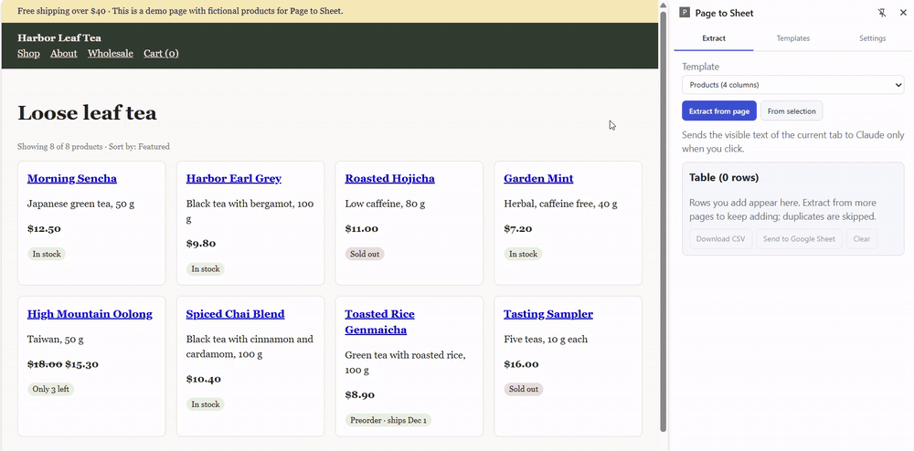

# Page to Sheet

A Chrome extension (Manifest V3) that turns the page you are reading into a clean table.
Pick the columns you want, click **Extract**, review what the AI found, then download a CSV or append the rows to your own Google Sheet.



- **Any columns you like.** Templates hold column names plus a short hint for the AI ("price with currency"). Three examples are included: products, events and a business directory.
- **Claude or OpenAI.** Uses structured output on both, so every answer is a list of rows with exactly your columns.
- **You review before anything is saved.** Extracted rows appear in an editable table; empty cells are highlighted.
- **No duplicates.** Mark the key columns of a template (for example *Name*, or *Title + Date*). Running the same page twice adds nothing; the Apps Script receiver checks the sheet the same way.
- **Private by design.** No server of ours. API keys stay in `chrome.storage.local`. The page is read only when you click, and only the visible text of that tab is sent to the AI you chose. Site access is requested per site, at the moment you use it.

## Install (developer mode)

```bash
npm install
npm run build
```

Open `chrome://extensions`, turn on **Developer mode**, click **Load unpacked** and choose the `dist` folder. Click the toolbar icon to open the side panel, then add your API key under **Settings**.

## Try it

The `demo/` folder has three fictional pages. Serve them locally (for example `npx serve demo` or `python -m http.server -d demo 8080`), open one, choose the matching template and click **Extract from page**. To read only part of a page, select it and click **From selection**.

## Send rows to Google Sheets

1. Open the target spreadsheet, then **Extensions > Apps Script**, and paste [`apps-script/Code.gs`](apps-script/Code.gs).
2. **Project Settings > Script properties**: add `TOKEN` with a long random value.
3. **Deploy > New deployment > Web app**, execute as *Me*, access *Anyone*. Copy the `/exec` URL.
4. In the extension's **Settings**, paste the URL and the same token.

The script creates the tab with a header row on first use, adds new columns if a template grows, skips rows whose key columns already exist, and stores text so it can never run as a formula. Requests without the token are rejected.

## How it works

| Part | File |
|---|---|
| Read the visible text of the tab (or the selection) | `src/lib/page.ts` |
| Prompt and row clean-up shared by both providers | `src/lib/rows.ts` |
| Claude via the official SDK, structured output with a Zod schema built from the template | `src/lib/providers/claude.ts` |
| OpenAI chat completions with a strict JSON schema | `src/lib/providers/openai.ts` |
| Duplicate detection (normalised key columns, FNV-1a) | `src/lib/dedupe.ts` |
| CSV with BOM and formula-injection guard | `src/lib/csv.ts` |
| Google Sheets receiver | `apps-script/Code.gs` |

Long pages are cut at 60,000 characters and the panel says so; select a section to read the rest. If a page has more items than fit in one answer, the panel asks you to select a smaller part instead of returning a partial list silently.

## Development

```bash
npm test        # unit tests (Vitest)
npm run build   # type check + production build into dist/
```

## Not included on purpose

Automatic crawling, following "next page" links, background monitoring and anything that works around logins. The extension reads only what you can already see, when you ask it to. Check a site's terms before extracting from it.

## License

MIT
